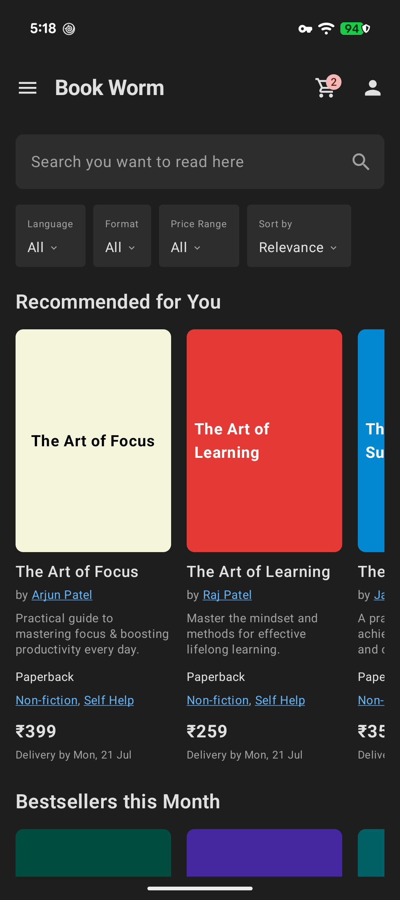
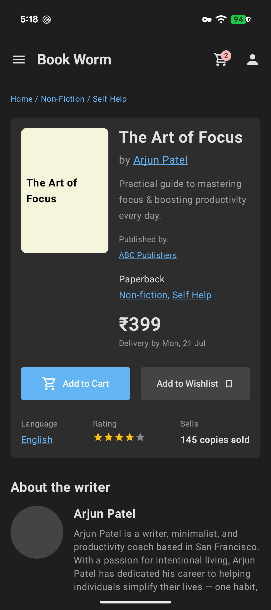
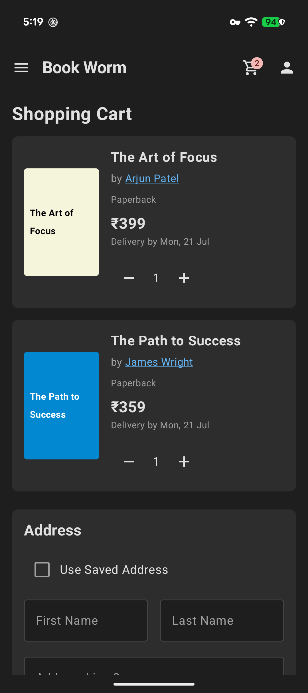
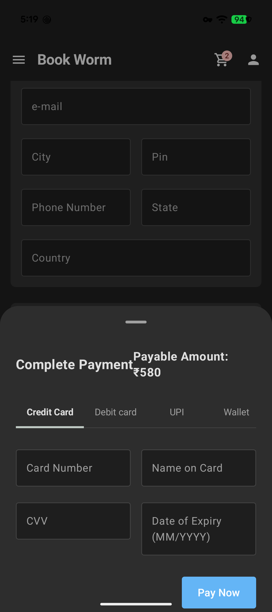
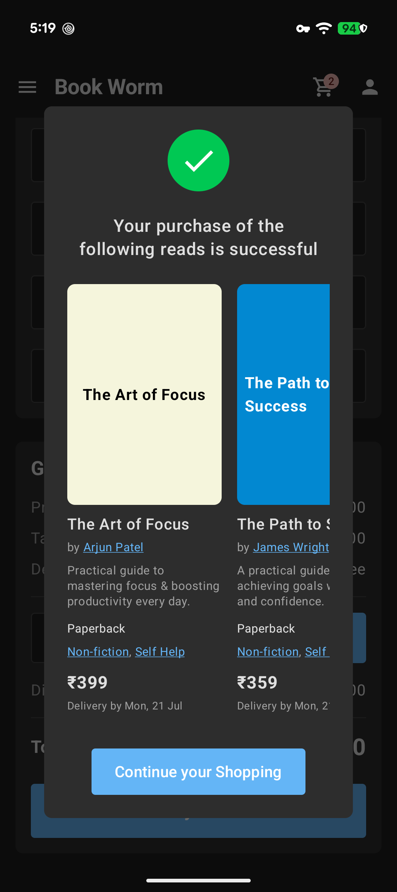

# My Book Store (Book Worm) 📚📱

**My Book Store** (branded as **Book Worm**) is a modern, full-featured Android application built with **Jetpack Compose** and **Material 3**. It offers an intuitive e-commerce book shopping experience featuring catalog browsing, detailed book reviews, full shopping cart management, interactive address input, and a multi-method payment modal.

---

## 📱 Screenshots

| Home & Catalog | Book Details | Shopping Cart |
| :---: | :---: | :---: |
|  |  |  |

| Payment Methods | Order Confirmation |
| :---: | :---: |
|  |  |

---

## ✨ Features Supported

### 📖 1. Home & Catalog Browsing
- **Search & Filtering**: Search bar placeholder for quick lookup and filter options for *Language*, *Format*, *Price Range*, and *Sort by* (Relevance).
- **Curated Recommendations**: Horizontal carousels featuring *Recommended for You* and *Bestsellers this Month*.
- **Navigation Drawer**: Side drawer for account links (*My Orders*, *My Wishlist*, *My Writers*) and quick category navigation (*Romance*, *Mystery*, *Sci-Fi*, *Self-help*, etc.).
- **Top App Bar**: Custom app bar showing app branding ("Book Worm"), navigation menu icon, shopping cart icon with live badge counter, and profile shortcut.

### 🔍 2. Product Detail Screen
- **Breadcrumb Navigation**: Shows path context (e.g. `Home / Non-Fiction / Self Help`).
- **Comprehensive Book Info**: Visual book cover, title, author link, description, publisher details, format, category tags, price, and delivery estimate.
- **Action Buttons**: One-click **Add to Cart** and **Add to Wishlist**.
- **Metrics & Ratings**: Book statistics showing language, star ratings, and total copies sold.
- **Author Biography**: Dedicated *"About the writer"* section highlighting author history and background.
- **User Reviews & Ratings**: Submit review form with character limit, star rating input, and community review cards.
- **Related Reads**: Carousel suggesting similar books.

### 🛒 3. Shopping Cart & Address Selection
- **Item Management**: Detailed cart list displaying items, book details, pricing, delivery dates, and quantity increment/decrement controls.
- **Address Input**: Shipping address form with options for using saved addresses or entering full address details (Name, Email, City, Pin, Phone, State, Country).
- **Order Summary Breakdown**: Automatic calculation of item prices, taxes, free delivery options, coupon code field with discount application, and total order calculation.

### 💳 4. Payment Gateway Integration
- **Multi-Tab Payment Sheet**: Modal bottom sheet supporting multiple payment methods:
  - **Credit Card**
  - **Debit Card**
  - **UPI**
  - **Wallet**
- **Payment Details Entry**: Secure input fields for Card Number, Cardholder Name, CVV, and Expiry Date.
- **Dynamic Payable Amount**: Prominent display of total payable order amount.

### 🎉 5. Order Confirmation & Success
- **Success Dialog**: Visual checkmark indicator celebrating completed purchases.
- **Purchased Items Preview**: Lazy row displaying books included in the completed order.
- **Seamless Navigation**: *"Continue your Shopping"* button allowing smooth return back to the catalog.

---

## 🛠️ Tech Stack & Architecture

- **Language**: [Kotlin](https://kotlinlang.org/)
- **UI Framework**: [Jetpack Compose](https://developer.android.com/jetpack/compose) (Material 3)
- **Navigation**: Jetpack Compose Navigation (`NavHost`, `rememberNavController`)
- **Theme & Design**: Custom Dark Theme palette with custom typography and components
- **Target SDK**: Android 15 (API 35) / Compile SDK 35
